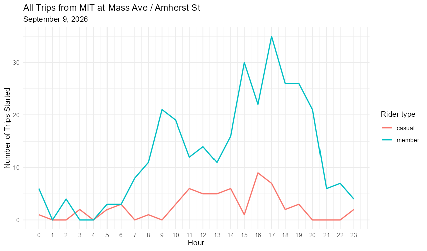
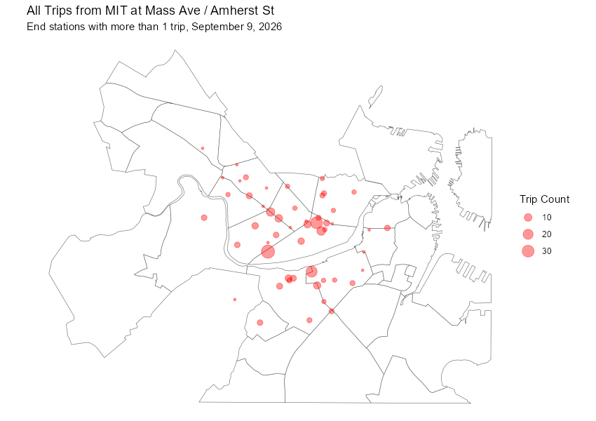

::: instruction
#### Instructions

This exam has **4 questions, 10 points each**. All necessary data files for this exam are uploaded to Canvas. You will use Quarto (`.qmd`) document to work on the question. When you finish, please **upload both your `.qmd` and rendered `.html` files** to the **“Midterm Exam” assignment** submission link on Canvas.

You have **90 minutes** to complete the exam from 9:30AM to 11:00AM.

Start your work in a Quarto document. To ensure that your rendered HTML includes all image outputs, copy and edit the following into your YAML header:

```{verbatim}
title: "Exam Answers"
author: "<Your Name>"
format:
  html:
    embed-resources: true
execute:
  warning: false
```

For the questions, please write out all your code you used, and include a clear final answer to a question. If you didn't complete a section, describe your problem-solving approach instead, i.e. explain what you intended to do and your reasoning.
:::

### Question 1: Cleaning and Transforming

You are given `q1_forest_area.csv`, which records the forest area of 80 countries over time. Each row is one country in one year. It has four columns:

-   `country`: Country name
-   `code`: 3-letter country code
-   `year`: Year of the record
-   `forest_area_ha`: Forest area in hectares

Questions:

1.  Filter the data for **Angola**. How many years of records does Angola have, and what are the first and last years? Then do the same for **Belgium**. (1 point)

2.  Not every country has a record for every year. Create **one summary table** that counts the number of years recorded for each country. Using this table, list all countries with **fewer than 31 years** of records. (2 points)

3.  Back to the original table, for the year **2020** only, which **3 countries** have the largest forest area? (2 points)

4.  Use the original table, keep only the years **1990 and 2020**, then use `pivot_wider()` to reshape the data so that each country is one row, with one column for 1990 forest area and one column for 2020 forest area. Your result should have 4 columns. Call this table `forest_wide`. (2.5 points)

5.  Using `forest_wide`, create a new column for the **change in forest area from 1990 to 2020**. Remove countries with a missing value (`NA`) in this column. Which country had the **largest decrease** in forest area during the 30 years? (2.5 points)

::: footnote
Data source: Forests and Deforestation in [Our World in Data](https://ourworldindata.org/forests-and-deforestation). Adapted dataset from [TidyTuesday](https://github.com/cnicault/tidytuesday) [2021-15 Global Deforestation](https://github.com/cnicault/tidytuesday/tree/master/2021/2021-15-global_deforestation).
:::

------------------------------------------------------------------------

### Question 2: Summarizing and Plotting

Bluebikes is Metro Boston's public bike share program. You are given a Bluebikes ridership dataset `q2_bike_trips.csv`. Each row represents a single trip, including its start time (`started_at`), end time (`ended_at`), start station, end station, and rider type (`member_casual`: `"member"` or `"casual"`). The dataset covers all trips taken on **Wednesday, September 9, 2026**, the first day of our fall semester.

**Q2.1**

1.  Filter for all trips that **started** at the station **“MIT at Mass Ave / Amherst St”**. Save the result as a new table, e.g. `mit_trips`. (1 point)

2.  The last two columns of the data, `started_hour` and `ended_hour`, give the hour (0-23) in which each trip started and ended. Using `started_hour`, create a **line graph** that shows the number of trips by hour at this station, with **two lines**: one for member riders and one for casual riders. **Include a title and x-axis tick labels by hour.** (7 points)

Your graph may look similar (but not the same!) as the following example. Your theme, color and text choices can be different.

{width="700"}

**Q2.2** Continue using `mit_trips` (all trips that started at “MIT at Mass Ave / Amherst St”).

1.  Create a table that shows how many trips **ended** at each station. In other words, count by `end_station_id`. Keep only the end stations with **more than 1 trip** (i.e., `n > 1`). You will use this result in Question 3. (2 point)

::: footnote
Data source: Bluebikes System Data. (2026). [Bluebikes Comprehensive Trip Histories](https://bluebikes.com/system-data).
:::

------------------------------------------------------------------------

### Question 3: Combining and Mapping

You are also provided a Bluebikes station dataset `q3_bike_stations.csv`, which includes station names (`NAME`), ids (`Number`), locations (`Lat`, `Long`), and total docks at each station.

1.  Join your result from Q2.2 (end stations with more than 1 trip) with the station dataset, **matching on station id**. Your result should have 53 rows (2 points)

2.  Using the `sf` package, map these trip counts using the stations' geographic locations. (8 points)

    -   Remove any stations without valid location information (`Long`, or `Lat`) after the join.
    -   Convert the joined data to an `sf` object.
    -   Use point `size` to show **the number of trips ending at each station** (as one `aes()` argument).
    -   Use `q3_basemap.geojson` as your base map.
    -   Include a title and a legend.

Your map may look similar (but not the same!) as the following example. Your theme, color and text choices can be different.

{width="700"}

::: footnote
Data source: Bluebikes System Data. (2026). [Bluebikes Stations](https://bluebikes.com/system-data). Analyze Boston. (2026). [Boston neighborhood boundary](https://data.boston.gov/dataset/bpda-neighborhood-boundaries).
:::

------------------------------------------------------------------------

### Question 4: Census Data Collection

In this question you will use the `tidycensus` package to collect American Community Survey (ACS) data. The following code is meant to download **the number of occupied housing units** and **renter-occupied housing units** for every **census tract in Middlesex County, Massachusetts**, from the most recent ACS 5-year estimates.

1.  Fill in the missing `variables` argument so the code runs correctly. Look for table `B25003`: Tenure. (4 points)
2.  Using your result of API call, create a new column `rate` that equals renter-occupied housing units divided by total occupied housing units, so that we have renter rate for each tract. (6 points)

```{r}
#| eval: false
library(tidycensus)

tenure <- get_acs(
  geography = "tract",
  state = "MA",
  county = "Middlesex",
  variables = ,
  year = 2024,
  survey = "acs5"
)
```

<br><br>

------------------------------------------------------------------------

🎉**THIS IS THE END OF THE EXAM** 🎉
